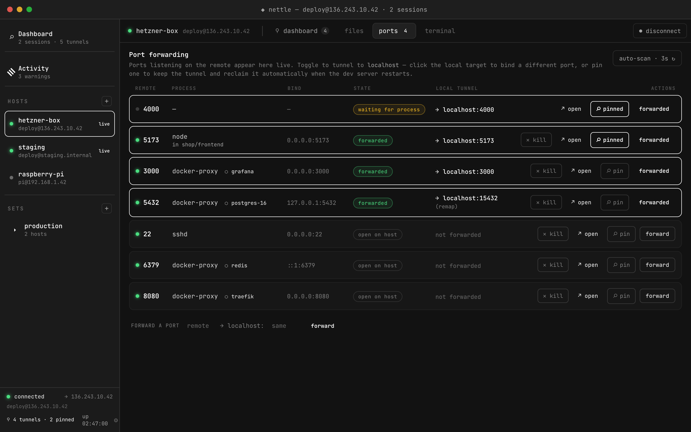
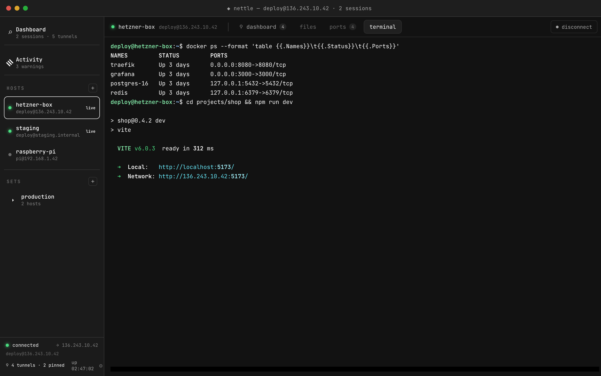
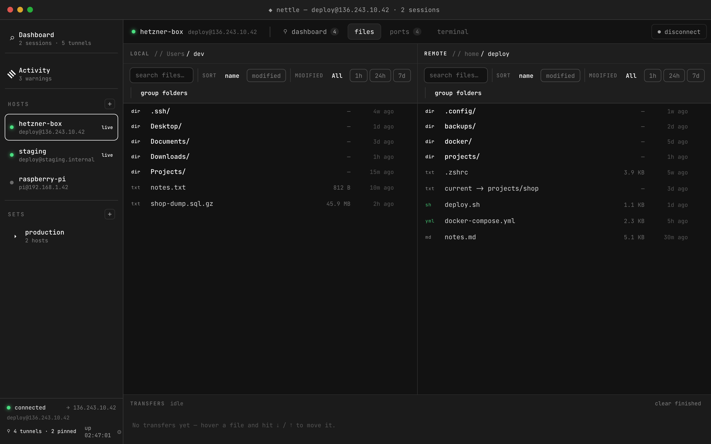
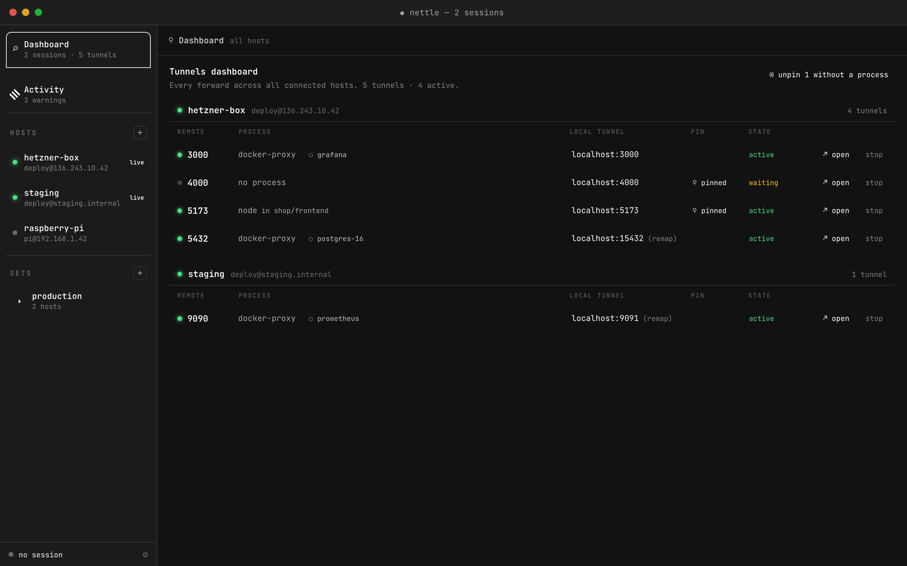
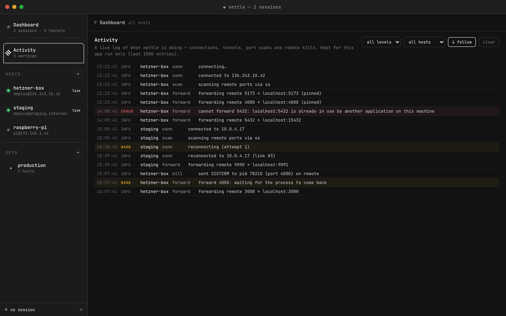

# ◆ nettle

**A resilient SSH client that treats flaky links and restarting dev servers as normal.**

[](https://github.com/gitu/nettle/actions/workflows/ci.yml)
[](https://github.com/gitu/nettle/releases)



nettle is a cross-platform desktop SSH client (macOS / Linux / Windows) built for
day-to-day work against remote dev boxes:

- **Live port discovery** — nettle watches which TCP ports are listening on the
  remote (process name and working directory included, so two `node` servers
  are easy to tell apart) and shows them the moment they appear. A new dev server
  pops a toast: *Forward & pin / Just once / Ignore*. Need the port back? Kill
  the remote process right from the row (SIGTERM, or SIGKILL if it insists).
- **Pinned tunnels that survive everything** — a pinned forward keeps its local
  listener alive across remote process restarts *and* SSH reconnects. Kill your
  remote `vite dev`, start it again, and `localhost:5173` just works — no clicks.
- **Auto-reconnect with fresh DNS** — every reconnect attempt re-resolves the
  hostname, so a remote that comes back on a new IP address is picked up
  automatically. Your terminal reopens itself and tunnels resume.
- **Dual-pane file browser** — remote (SFTP) next to local, with a transfer
  queue, live progress, and cancellation. Transfers run on their own SSH
  channels and never block the terminal.
- **Real terminal** — a full PTY shell rendered with xterm.js.
- **Many hosts at once** — connect to several servers simultaneously; each
  keeps its own live terminal, tunnels, and transfers. Switching hosts leaves
  the others running (toggle off in About if you prefer one-at-a-time).
- **Tunnels dashboard** — one overview of every forward across every connected
  host, grouped by host, with process info, live/waiting status, open-in-browser
  and quick stop — plus one-click cleanup of pins whose process is gone.
- **Activity log** — an in-app log of everything nettle does (connections,
  tunnels, port scans, kills), filterable by host and severity. Bind conflicts
  surface as actionable errors with a known-free port to use instead.
- **Docker sandboxes** — on a host running Docker Sandboxes
  (`sbx`), the ports tab lists every sandbox and the ports listening inside
  it, its docker containers included. Forward one without `sbx ports`, then
  move the same local port to another sandbox with one click (*⇄ switch here*),
  so `localhost:4180` and the OAuth redirect on it stay the same. Ports a
  sandbox *advertises* are forwarded as soon as they listen, and its background
  services can be started, stopped and tailed from the app.
- **Connection sets** — name a group of hosts and bring them all up with one
  click (e.g. "production" = api + db + cache).
- **Tray-first** — closing the window hides nettle to the menu bar / system
  tray; sessions and every pinned tunnel keep running in the background.

<p>
  
  
  
  
</p>

## Install

**macOS / Linux (Homebrew):**

```sh
brew install --cask gitu/tap/nettle
```

**Windows (Scoop):**

```powershell
scoop bucket add gitu https://github.com/gitu/homebrew-tap
scoop install nettle
```

**Linux, direct download** of the latest release (needs `curl`):

Debian / Ubuntu:

```sh
curl -fsSL "$(curl -fsSL https://api.github.com/repos/gitu/nettle/releases/latest | grep -o 'https://[^"]*amd64\.deb')" -o nettle.deb && sudo apt install ./nettle.deb
```

(Without apt: `sudo dpkg -i nettle.deb`, then `sudo apt-get -f install` for missing
dependencies if dpkg reports any.)

openSUSE:

```sh
sudo zypper --non-interactive install --allow-unsigned-rpm "$(curl -fsSL https://api.github.com/repos/gitu/nettle/releases/latest | grep -o 'https://[^"]*\.x86_64\.rpm' | head -1)"
```

Fedora / RHEL can't install the `.rpm` yet: its package name `nettle` is taken there by
the system's GNU Nettle crypto library (a GnuTLS dependency), so dnf refuses it. Use the
AppImage below.

Any other distro (AppImage, needs FUSE 2: `libfuse2`):

```sh
mkdir -p ~/.local/bin && curl -fsSLo ~/.local/bin/nettle "$(curl -fsSL https://api.github.com/repos/gitu/nettle/releases/latest | grep -o 'https://[^"]*_amd64\.AppImage' | head -1)" && chmod +x ~/.local/bin/nettle
```

**Windows, direct download:**

```powershell
$u = (Invoke-RestMethod https://api.github.com/repos/gitu/nettle/releases/latest).assets.browser_download_url -match 'x64_en-US\.msi$'
Invoke-WebRequest $u -OutFile nettle.msi; msiexec /i nettle.msi
```

Or grab the latest build from [Releases](https://github.com/gitu/nettle/releases):
`.dmg` for macOS (Apple Silicon and Intel), `.AppImage` / `.deb` / `.rpm` for
Linux, `.msi` / `.exe` for Windows.

Builds are currently unsigned. On macOS the first launch needs
*right-click → Open* (or `xattr -dr com.apple.quarantine /Applications/nettle.app`);
on Windows, allow the SmartScreen prompt.

## Security model

- **Host keys**: trust-on-first-use with an explicit fingerprint prompt, stored
  in an OpenSSH-format `known_hosts` under nettle's config dir. A changed key is
  a hard failure (possible MITM) — there is deliberately no "accept anyway" button.
- **Auth**: ssh-agent first (`$SSH_AUTH_SOCK`, or the Windows OpenSSH agent
  named pipe), then a configured private key (encrypted keys prompt for the
  passphrase), then password. Passwords/passphrases are held in an in-memory
  vault (per host) for the app's runtime — never written to disk — so
  auto-reconnects, disconnect/reconnect cycles, and host switching don't
  re-prompt. Quitting the app forgets everything.
- Host definitions (`hosts.json`) contain no secrets.

## Docker sandboxes

When a connected host has the `sbx` CLI, the ports tab gets a *target* bar with
the host and each of its sandboxes. Nothing needs to be published with
`sbx ports`: every tunnel is an `sbx exec -i <sandbox> socat …` bridge on an SSH
exec channel, so services bound only to a sandbox's loopback work too.

- **Switching:** forwards are keyed by local port. Forwarding sandbox B's 4180
  while `localhost:4180` tunnels to sandbox A switches the listener in place,
  and a pin moves with it.
- **Advertised ports:** a sandbox lists ports in `/etc/nettle/ports` (defaults)
  and `~/.config/nettle/ports` (the agent's), `PORT [label]` per line. nettle
  forwards each to the same local port once it listens, unless that port is
  taken; a forward you stop stays stopped.
- **Services:** with an `sbx-svc` command in the sandbox, a Services panel shows
  each service with start / stop / restart and a live log view.
- Stopped sandboxes are listed but never started.

Host setup, the file formats, the `sbx-svc` contract, how to make the agent
advertise its ports, and ready-made kits ([sbx-forge](https://github.com/gitu/sbx-forge)
or a minimal one of your own): **[docs/sandboxes.md](docs/sandboxes.md)**.

## Remote control (optional)

nettle can run a small local HTTP server so you can browse and move files on your
connected hosts — and connect/disconnect or toggle port forwards — from your
phone or another browser. Open **About → Remote control…** to configure it.

- **Off by default.** Enabling it mints a random 128-bit token that is embedded
  in a link the app hands you (the token rides in the URL *fragment*, so it is
  never sent to the server in the clear or written to its logs). Opening the link
  loads a small, self-contained web panel that authenticates with that token.
- **Localhost by default.** The server binds to `127.0.0.1:8760` (the port is
  configurable in the dialog); the link only works on this machine. Flip
  **"reachable from the local network"** to bind `0.0.0.0` and get a link with
  your LAN IP for use from another device — at which point anyone on your network
  who has the link can reach your hosts, so keep it private.
- **The token is the only credential.** Every `/api/*` call requires it (as a
  `Authorization: Bearer` header or `?t=` query param); regenerate it any time to
  instantly revoke every previously-issued link. No remote shell is exposed over
  the web.

## Architecture

Tauri v2 · Rust backend (`russh` + `russh-sftp`) · React + TypeScript frontend.

The backend is built around a **connection epoch** model: one actor task owns
the reconnect state machine and publishes `Arc<ConnectionEpoch>` (a cheap-clone
russh handle + a cancellation token) through a `tokio::sync::watch`. Every
subsystem — terminal, SFTP browser, transfer workers, port scanner, forward
manager — races its work against the epoch's cancellation token and re-attaches
to the next epoch after a reconnect. Pinned forwards keep their local
`TcpListener`s *outside* the epoch lifecycle, which is what makes tunnels
survive reconnects for free.

Port discovery execs `ss -tlnp` on the remote every 3 s (falling back to
`netstat`, then `/proc/net/tcp`), diffs the result, and feeds both the UI and
the forward manager. The parsers are pure functions with fixture tests.

Tunnelled connections are pumped directly on the russh channel (no
`into_stream` + `copy_bidirectional`): a remote `Close` ends the connection
immediately, a half-closed connection may linger for at most 30 s, and every
byte is accounted for.

Each host keeps **connection statistics** for the app's runtime (`stats.rs`):
links established, drops with their cause, failed attempts, connected time,
tunnel connections/bytes, and port-scan health. They live on the `UiBridge`,
so they survive reconnects and manual disconnects, and are pushed to the UI as
`conn-stats` events at most once per second (and only when something changed).
The dashboard shows them per host; the sidebar footer shows the essentials.

The backend never touches the Tauri runtime directly — events go through an
`EventSink` trait — so the entire SSH stack runs headless in integration tests.

```
src-tauri/src/
├── ssh/        session actor (reconnect + fresh DNS), auth, host keys
├── terminal.rs PTY channel with output coalescing
├── sftp/       browse session + concurrent transfer queue
├── ports/      scanner + parsers + forward manager + Docker sandboxes (sbx)
├── stats.rs    per-host runtime connection statistics
├── web.rs      optional token-authorized HTTP control server (axum)
└── ipc/        Tauri commands & typed event payloads
src/            React UI (zustand store, xterm.js terminal)
```

## Development

Prerequisites: Rust (stable), Node 22+, pnpm. On Linux additionally:
`libwebkit2gtk-4.1-dev libgtk-3-dev libayatana-appindicator3-dev librsvg2-dev`.

```sh
pnpm install
pnpm tauri dev      # run the app
pnpm build          # typecheck + bundle the frontend
```

## Testing

Unit tests (parsers, config store) run everywhere:

```sh
cd src-tauri && cargo test --lib
```

The integration suite drives the real backend — connect, TOFU, PTY terminal,
SFTP roundtrip, direct-tcpip tunnel, reconnect with cached auth — against a
disposable sshd:

```sh
docker run -d --name nettle-sshd -p 2222:2222 \
  -e PASSWORD_ACCESS=true -e USER_PASSWORD=nettletest -e USER_NAME=deploy \
  lscr.io/linuxserver/openssh-server:latest
docker exec nettle-sshd sed -i \
  's/^AllowTcpForwarding no/AllowTcpForwarding yes/' /config/sshd/sshd_config
docker exec nettle-sshd sh -c 'kill -HUP $(cat /config/sshd.pid)'

cd src-tauri && NETTLE_E2E=1 cargo test --test e2e
```

CI runs the full suite (fmt, clippy `-D warnings`, unit, E2E against sshd, and
the frontend build) on every push; tagging `v*` builds and publishes installers
for all three platforms and updates the Homebrew cask (macOS + Linux) and Scoop manifest (Windows) from
`packaging/*.tmpl` (needs the
`HOMEBREW_TAP_TOKEN` secret — a PAT with write access to `gitu/homebrew-tap`).
Each release is built as a draft and published once every platform's installers
are attached, so `releases/latest` (which the direct-download commands use)
always has the full set.

To release, push a `vX.Y.Z` tag on `main` — nothing else. The release workflow
injects the version from the tag into `tauri.conf.json` before building, so the
version fields committed in `tauri.conf.json` / `Cargo.toml` / `package.json`
only affect local dev builds and don't need to be bumped per release (nudge them
occasionally so `pnpm tauri dev` shows something close to reality).

## Signing macOS builds

Release DMGs are ad-hoc signed until Apple credentials are configured. To ship
properly signed + notarized builds you need an
[Apple Developer Program](https://developer.apple.com/programs/) membership,
then:

1. In Xcode or [developer.apple.com](https://developer.apple.com/account/resources/certificates/list),
   create a **Developer ID Application** certificate and export it (with its
   private key) as a `.p12`.
2. Create an **app-specific password** for your Apple ID at
   [appleid.apple.com](https://appleid.apple.com) (used for notarization), and
   note your 10-character **Team ID**.
3. Add these repository secrets (Settings → Secrets → Actions):
   - `APPLE_CERTIFICATE` — the `.p12`, base64-encoded (`base64 -i cert.p12 | pbcopy`)
   - `APPLE_CERTIFICATE_PASSWORD` — the `.p12` export password
   - `APPLE_SIGNING_IDENTITY` — e.g. `Developer ID Application: Your Name (TEAMID)`
   - `APPLE_ID`, `APPLE_PASSWORD` (the app-specific password), `APPLE_TEAM_ID`

The release workflow already forwards these to `tauri-action`; the next tagged
release will be signed, notarized, and stapled automatically — no Gatekeeper
prompt, and the Homebrew cask caveat can be dropped.

## License

[MIT](LICENSE)
